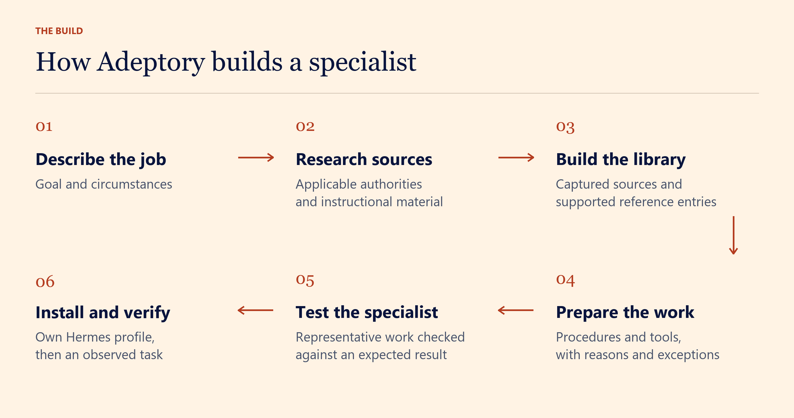

# Adeptory

[](docs/assets/adeptory-hero-full.webp)

[Download the full-size WebP, 1774 × 887](docs/assets/adeptory-hero-full.webp) · [Artwork and diagram files](docs/assets/README.md)

Give intelligence an education.

Tell Hermes the job you need done. Adeptory researches the profession and builds a specialist with its own searchable library. Its procedures explain why each step exists and which exceptions can change the recommendation.

Adeptory tests the specialist on representative work and delivers its own Hermes profile.

## Give it the why

A grant specialist should be able to explain which rule makes an applicant eligible and which missing evidence could change that answer.

Adeptory keeps those conditions beside the procedure, along with the supporting source passages. You can inspect what the specialist worked from and question how it reached its recommendation.

## A library built for the job


Your specialist gets its own `library/` directory. It can search the original sources alongside the procedures built from them.

Each procedure keeps its supporting passages and the conditions under which its advice applies. When a source changes, Adeptory marks the affected entries for review.

Read [Library and source records](docs/source-ledger.md) for the evidence fields and freshness rules.

## Let it build the next tool


A specialist can encounter a task worth turning into a reusable tool. It records what the tool should do and how to test it, then builds it through the host tools you've authorized.

In a tested grant-operations follow-up, the specialist built a tool for tracking application evidence that passed 22 checks. It saved the tool and its method for later use.

Your original request continues to authorize ordinary work within the same mission. Changes to that mission reopen review.

Read [Tool setup](docs/tool-setup.md) for capability requirements and verification.

## Install in your Hermes profile

Adeptory requires Hermes 0.23.1 or later and a configured model. Use the Hermes profile where you normally work.

In Hermes Desktop, open **Capabilities > Plugins** and install from this repository's Git source. Review the permissions and enable Adeptory. Follow any reload instruction Hermes displays.

In PowerShell, install the same source with the Hermes CLI.

```powershell
hermes plugins install https://github.com/brefledev/adeptory `
	--enable
```

After the Hermes catalog accepts Adeptory, you can also install it by name through the catalog.

## Build your first specialist

Open a new chat in the profile where you installed Adeptory. Send your request with `/adeptory build`.

```text
/adeptory build a Grant Operations specialist for our community
arts nonprofit. Research official grant rules, build its own
searchable library and application-readiness tools, and test it
on a fictional packet before delivering its Hermes profile.
```

You can also describe the job in ordinary conversation and ask Hermes to use Adeptory. Send `/adeptory` for the welcome message.

### What Adeptory does next

[](docs/assets/specialist-workflow.webp)

<details>
<summary>Read the steps</summary>

<ol>
<li>Describe the job and the circumstances that affect it.</li>
<li>Research applicable authorities and instructional material.</li>
<li>Build the source library and supported reference entries.</li>
<li>Prepare procedures and tools, including their reasons and exceptions.</li>
<li>Check representative work against an expected result.</li>
<li>Install the specialist's own Hermes profile and observe an ordinary task.</li>
</ol>

</details>

On first use, Hermes may ask whether Adeptory can start an AI reply when you submit a specialist request. Choose **Allow automatic replies** to continue from the request you already sent. The reply uses your current model and its normal usage charges.

Adeptory displays the build in Hermes's **Tasks** panel. It researches sources, organizes the library, prepares the specialist's procedures and tools, and checks a representative result. Required questions appear in Hermes's native question controls. Adeptory continues work that can proceed while facts remain unresolved.

When the build passes its completion checks, Adeptory reports the installed profile, its library, and the demonstrated result. Select that profile in Hermes and give the specialist a task. Your original request authorizes ordinary use of the specialist. Actions that require host permission retain that permission step.

## Keep working after an interruption

The original request and construction progress stay in the builder profile. Return to the same conversation and ask Adeptory to continue. Hermes controls Stop and interruption. Adeptory resumes the saved build when you request it.

## Data, permissions, and costs

Adeptory stores the request, specialist records, construction progress, observations, and receipts in the active Hermes profile. A generated profile receives its specialist instructions and library. Source retrieval and tool execution use the host tools you authorize. Your model provider and connected tools apply their usual data policies and charges.

Building a specialist can require many model calls and source downloads. The size of the task, the available tools, and the chosen model determine the work. Adeptory records missing capabilities and source-access failures with the affected build tasks.

Source capture, passage matching, and a successful demonstration establish their recorded scope. Professional conclusions still depend on the supplied evidence, applicable rules, source currency, and the task. Consequential decisions may require a qualified professional's review.

## Reference

The [Hermes integration](docs/api-evidence.md) lists the registered tools, hooks, middleware, and host actions. The [record reference](docs/interfaces.md) describes specialist packages and construction state. [Development checks](docs/development.md) cover tests and catalog validation.
